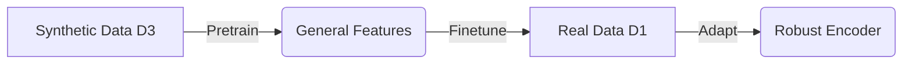

# Step 3: Encoder Training

Train encoders to predict latent codes from partial point clouds.

---

## Overview

The encoder learns to map partial observations → latent codes that reconstruct complete shapes.

**Input**: Partial point clouds (synthetic or real)  
**Output**: Trained encoder that predicts latent codes  
**Goal**: Learn a latent space that captures **Shape** (geometry) and **Size** (volume).

---

## Available Encoders

| Encoder | Type | Normalization | Best For | Config Prefix |
|---------|------|---------------|----------|---------------|
| **PCE** | PointNet-style | **Raw (Meters)** | Dense clouds, Volume estimation | `pce_*` |
| **Minkowski** | Sparse Conv | **Normalized ([-1,1])** | Sparse clouds, High fidelity detail | `minkowski_*` |
| **Pool** | RGBD Pooling | Normalized | RGB-D images | `super3d` |

**Volume Estimation Note**: 
- **PCE/FoldNet**: Require **RAW** physical coordinates (e.g., `normalize_pcd: false`) to learn volume variance.
- **Minkowski**: Typically works with **NORMALIZED** coordinates (e.g., `normalize_pcd: true`) for stability in voxelization.

---

## Training Strategies

### Strategy 1: Pretrain + Finetune (Recommended)

**Best for:** Small real datasets (e.g. < 50 samples) to prevent overfitting/latent collapse.



**Workflow:**
1.  **Pretrain** on synthetic partial data (learns structure).
2.  **Finetune** on real Orbbec data (learns noise distribution).

### Strategy 2: Train from Scratch

**Best for:** Large, clean real datasets.

**Workflow:**
1.  **Train** directly on real Orbbec data.

---

## Quick Start (PCE Example)

### Option A: Pretrain + Finetune (Recommended)

```bash
# Step 1: Pretrain on synthetic data (Phenobox)
python3 train.py \
    -e deepsdf/experiments/kmelon_latent32 \
    -c configs/kmelon/latent_32/pce_phenobox.json \
    --checkpoint_decoder 210

# Step 2: Finetune on real data (Orbbec)
# (Update 'pretrained_encoder' in config first!)
python3 train.py \
    -e deepsdf/experiments/kmelon_latent32 \
    -c configs/kmelon/latent_32/pce_finetune_orbbec.json \
    --checkpoint_decoder 210
```

### Option B: Train from Scratch

```bash
python3 train.py \
    -e deepsdf/experiments/kmelon_latent32 \
    -c configs/kmelon/latent_32/pce_orbbec_fromscratch.json \
    --checkpoint_decoder 210
```

---

## Configuration Guide

Configs are located in `configs/kmelon/latent_32/` (or other latent sizes).

### Common Parameters

| Parameter | Recommended Value | Description |
|-----------|-------------------|-------------|
| `encoder` | `point_cloud` | Encoder architecture (PCE) |
| `input_size` | `1024` | Number of points per input cloud |
| `batch_size` | `12` | Batch size |
| `lr` | `0.0001` (Pretrain) / `0.00001` (Finetune) | Learning rate (10x lower for finetuning) |
| `normalize_pcd` | `false` (PCE) / `true` (Mink) | **CRITICAL**: Controls input normalization |
| `orbbec_pcd_suffix` | `_preprocessed` | Suffix for input files |

### Dataset Selection

| Config Key | Pretrain (Synthetic) | Finetune (Real) |
|------------|----------------------|-----------------|
| `use_phenobox_pcd` | `true` | `false` |
| `use_orbbec_pcd` | `false` | `true` |
| `phenobox_subdir` | `phenobox/pointclouds` | - |
| `orbbec_pcd_suffix` | - | `_preprocessed` |

---

## Preprocessing Orbbec Data

Real data must be preprocessed to remove noise and center it before use.

### Script
```bash
python3 preprocess_greenhouse_pcd.py
```
**Effect**:
- Reads raw scans from `S*/orbbec/pointclouds/*.ply`
- Denoises and centers them
- Saves new files with suffix `_preprocessed.ply`

**Config Usage**:
If your config has `"orbbec_pcd_suffix": "_preprocessed"`, the dataloader reads these cleaned files.
If you set it to `""`, it will read the raw files (NOT recommended).

---

## Troubleshooting

### 1. "Latent Collapse" (Predicted Volume has no variance)
- **Cause**: Input normalization is ON, removing physical scale info.
- **Fix**: Ensure `normalize_pcd` is `false` for PCE/PointNet encoders. Check `verify_normalization_switch.py`.

### 2. "Pretrained encoder file not found"
- **Cause**: Incorrect path in `pce_finetune_orbbec.json`.
- **Fix**: Update `pretrained_encoder` to point to your actual `*_best_model.pt` from the pretraining run.

### 3. "CUDA Out of Memory"
- **Fix**: Reduce `batch_size` (e.g. 12 -> 8).

### 4. "Validation RMSE is high / diverging"
- **Fix**: 
    - Reduce learning rate (`lr`).
    - Ensure `split_json` is correct (don't train on val set!).
    - Check if `supervised_3d` is true (latent supervision helps stability).

---

## Next Steps

After training, evaluate the model:
→ **[Step 4: Evaluation](04_EVALUATION.md)**
