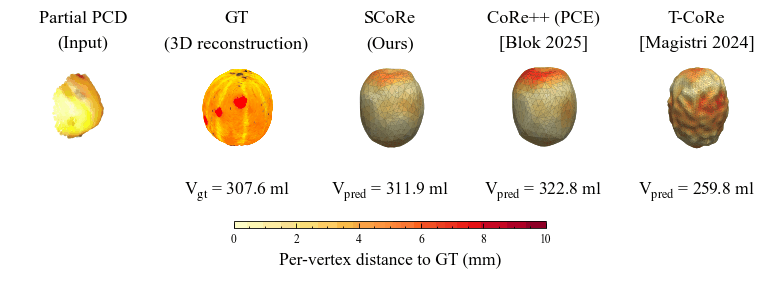

# SCoRe: Sequential CoRe for 3D Shape Completion of Oriental Melon

> **Parameter-free temporal latent fusion** that extends single-frame CoRe-based 3D shape completion (Blok et al., 2025) into a per-fruit sequence model. The fusion adds **no learned parameters at deployment**; at the first visit, the output reduces to the single-frame encoder output. Used to track per-fruit volume across the growing season for oriental melon (*Cucumis melo* L. var. *makuwa*).



---

## Overview

A robotic platform revisits each fruit every 2 to 3 days. Each visit produces one partial point cloud from an Orbbec Femto Mega RGB-D sensor, and SCoRe accumulates information across visits in the latent space of a frozen DeepSDF decoder. The trajectory, rather than any single snapshot, becomes the relevant signal for downstream growth monitoring and harvest decisions.


- **Time-aware EMA** over the full latent — irregular session intervals are absorbed by α = 1 − exp(−Δt/τ); at τ = 3.5 days the prior and observation contribute equally when Δt = τ.
- **Hard monotone clamp** on the two leading principal directions of the within-fruit consecutive-frame latent change Δz = z_{t+1} − z_t. Fruit volume cannot decrease across visits; the running maximum is enforced per axis after PCA orientation.
- **Frozen DeepSDF decoder** — only the encoder is trained. Stage 3 (fusion) is inference time only and learns nothing.
- **Weak supervision** at fine-tuning via an **occupancy volume** V_occ = Σ σ(−SDF/T) · v_voxel, supervised against a per-fruit-corrected ellipsoid GT V_ell on intermediate frames.


---

## Repository Layout

```
corepp/
├── data_preparation/       # PCD generation, splits, augmentations, metadata
├── deepsdf/                # DeepSDF decoder (Park et al. 2019)
├── networks/               # Encoders (PCE, PCE-large, Minkowski) + decoder wrappers
├── temporal/               # SCoRe pipeline (inference path only)
│   ├── test.py             # inference: single-frame OR sequential (EMA + monotone clamp)
│   ├── train.py            # encoder pretrain + fine-tune (last-frame super + V_occ weak sup)
│   ├── core.py             # encoder builder, occlusion ops, fusion runtime
│   └── utils.py            # temporal metadata index
├── analysis/               # offline latent / size analyses
├── scripts/                # PCA pre-pass, ablation aggregation, figure builders
├── configs/kmelon/         # experiment configs (latent_64 = reference)
├── DOCS/                   # detailed walkthroughs
├── train.py / test.py      # static CoRe++ baseline entry points
└── train_deep_sdf.py       # DeepSDF decoder training
```

See [`CHANGELOG.md`](CHANGELOG.md) for the full diff against upstream `corepp`.

---

## Pipeline (3 Stages)

| # | Stage | Script | Reference config (D = 64, PCE-large, max + mean) |
|---|---|---|---|
| 1 | DeepSDF decoder | `train_deep_sdf.py` | `deepsdf/experiments/.../specs.json` |
| 2a | Encoder pretrain (138 synth meshes) | `train.py` | `configs/kmelon/latent_64/pce_pretrain_l64_large_maxmean_archMatch.json` |
| 2b | Encoder fine-tune (102 real fruits) | `train.py` | `configs/kmelon/latent_64/pce_finetune_v25_calFix_weakSoftvol_l64_large_maxmean_noAug_archMatch_e100_seed11_ftonly.json` |
| 3 | Temporal latent fusion *(inference only)* | `temporal/test.py` | `configs/kmelon/latent_64/temporal_archMatch_l64_large_maxmean_ema_pc1_monotone_tau3.5_seed11_ftonly.json` |

Stage 3 is parameter-free. The same fine-tuned encoder checkpoint produces both the single-frame CoRe++ baseline and the SCoRe sequence output; the only difference at inference is whether the fusion is applied.

---

## Headline Results (80-fruit test set, last frame, occlusion 0)

| Method | RMSE (ml) ↓ | MAPE (%) ↓ | F1 @ 5 mm (%) ↑ | d_CD (mm) ↓ |
|---|---:|---:|---:|---:|
| 2D De-occlusion + Reg (lower bound) | 95.0 | 31.21 | — | — |
| T-CoRe (Magistri et al. 2024) | 130.4 | 34.88 | 60.97 | 4.71 |
| CoRe++ (PCE-large, D = 64) | 81.8 | 23.24 | 69.74 | 4.14 |
| **SCoRe (this work)** | **46.6** | **14.08** | **86.84** | **2.75** |
| DeepSDF decoder, optimal GT latent (upper bound) | 8.3 | 1.28 | 99.12 | 1.07 |

Intermediate-frame RMSE against the corrected ellipsoid GT: **46.0 ml** (MAPE 22.0 %). Under heavy 60 % occlusion of the last frame, SCoRe holds last-frame RMSE at 63.6 ml (CoRe++ 110.9 ml) and F1 @ 5 mm at 77.0 %.


---

## Quick Start

### Environment

```bash
# Activate the corepp micromamba env (see ENV_SETUP.md for first-time setup)
source activate_corepp.sh
```

### Train the encoder (Stages 2a → 2b)

```bash
# Pretrain on 138 synthetic-occlusion meshes
CUDA_VISIBLE_DEVICES=0 python train.py \
    --cfg configs/kmelon/latent_64/pce_pretrain_l64_large_maxmean_archMatch.json

# Fine-tune on real partial PCDs from the 102 in-domain training fruits
CUDA_VISIBLE_DEVICES=0 python train.py \
    --cfg configs/kmelon/latent_64/pce_finetune_v25_calFix_weakSoftvol_l64_large_maxmean_noAug_archMatch_e100_seed11_ftonly.json
```

### Inference: single-frame baseline vs. SCoRe

```bash
# CoRe++ baseline (no fusion)
python temporal/test.py \
    --cfg <finetune_run>/pce_finetune_..._e100_seed11_ftonly.json \
    --checkpoint <finetune_run>/logs/checkpoints/best_model.pt \
    --no_temporal

# SCoRe (Stage 3: EMA[z] + M[pc1, pc2] at τ = 3.5 days)
python temporal/test.py \
    --cfg configs/kmelon/latent_64/temporal_archMatch_l64_large_maxmean_ema_pc1_monotone_tau3.5_seed11_ftonly.json \
    --checkpoint <finetune_run>/logs/checkpoints/best_model.pt
```

The PC1/PC2 growth axes are computed once per encoder by an offline PCA on within-fruit consecutive-frame Δz (see `scripts/`), then reused at inference.

---

## Dataset

210 oriental melon fruits across two seasons and three greenhouses at the Seongju Oriental Melon Research Institute, Korea:

| Season | Greenhouse | Cultivar | Window | Fruits | Sample ids |
|:---:|:---:|:---:|:---:|---:|:---:|
| 2025 | A | *Eliteggul* | 1 May – 4 Jun 2025 | 61 | `A1`–`A61` |
| 2026 | B | *Alchanggul* | 11 Mar – 16 Apr 2026 | 69 | `B1`–`B69` |
| 2026 | C | *Alchanggul* | 11 Mar – 16 Apr 2026 | 80 | `C1`–`C80` |

Split: 102 train / 28 validation / 80 *Alchanggul* test (greenhouse C, April 2026 last-frame window). Ground truth is a per-fruit multi-view 3D reconstruction at harvest (last frame) and a per-fruit-corrected ellipsoid volume from caliper height/width at every session (intermediate frames).

**Download: [`Sungjay/3DKoreanMelon`](https://huggingface.co/datasets/Sungjay/3DKoreanMelon)** · DOI [10.57967/hf/9982](https://doi.org/10.57967/hf/9982) · CC BY 4.0 · ~334 MB

```bash
hf download Sungjay/3DKoreanMelon --repo-type dataset --local-dir data/3DKoreanMelon
```

This code reads that layout directly, with no conversion step. See [`DOCS/00_PUBLIC_DATASET.md`](DOCS/00_PUBLIC_DATASET.md) for the run command and the trained weights.

---

## Documentation

| Doc | Contents |
|---|---|
| [`DOCS/00_PUBLIC_DATASET.md`](DOCS/00_PUBLIC_DATASET.md) | Running on the published dataset |
| [`DOCS/01_DATA_PREPARATION.md`](DOCS/01_DATA_PREPARATION.md) | Dataset layout, splits, metadata CSV |
| [`DOCS/02_DEEPSDF_TRAINING.md`](DOCS/02_DEEPSDF_TRAINING.md) | DeepSDF decoder workflow |
| [`DOCS/03_ENCODER_TRAINING.md`](DOCS/03_ENCODER_TRAINING.md) | Encoder pretrain & fine-tune |
| [`DOCS/04_EVALUATION.md`](DOCS/04_EVALUATION.md) | Metrics, baselines, ablations |
| [`DOCS/05_VISUALIZATION.md`](DOCS/05_VISUALIZATION.md) | Mesh / pointcloud visualization |
| [`DOCS/06_AUTOMATION.md`](DOCS/06_AUTOMATION.md) | Sweep / batch helpers |
| [`DOCS/TROUBLESHOOTING.md`](DOCS/TROUBLESHOOTING.md) | Common errors |

Some entries under `DOCS/` were written during the earlier Kalman-fusion design (see `DOCS/MIGRATION_GUIDE.md`) and are kept for historical reference.

---

## Acknowledgements & Citation

SCoRe builds on **CoRe++** by Blok et al.:

```BibTeX
@article{BLOK2025109673,
    title   = {High-throughput 3D shape completion of potato tubers on a harvester},
    author  = {Pieter M. Blok and Federico Magistri and Cyrill Stachniss and Haozhou Wang and James Burridge and Wei Guo},
    journal = {Computers and Electronics in Agriculture},
    volume  = {228},
    pages   = {109673},
    year    = {2025},
    doi     = {10.1016/j.compag.2024.109673},
}
```

CoRe++ itself extends Magistri's original CoRe ([magistri2022ral-iros](https://www.ipb.uni-bonn.de/wp-content/papercite-data/pdf/magistri2022ral-iros.pdf)), and the shape prior is the DeepSDF decoder of Park et al. ([CVPR 2019](https://arxiv.org/abs/1901.05103)).

---

## License

Inherits the upstream CoRe++ license — see [`LICENSE`](LICENSE).
